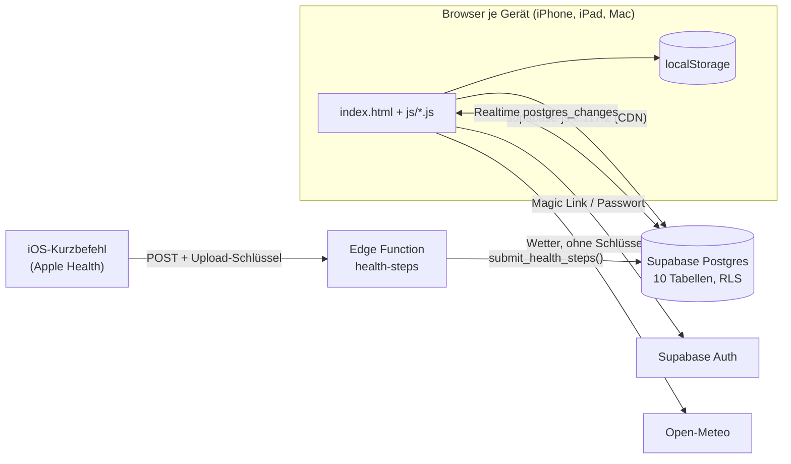

# Dali Life OS – Implementierungsstatus

**Stand:** 7. November 2026 · **Phase:** 0 – Repository-Audit und Datensicherung · **Status:** Audit
abgeschlossen, erster Umsetzungsschritt vorgeschlagen, **wartet auf Freigabe**
**Branch:** `lifeos/phase-0-audit` (abgezweigt von `main` @ `9e5a2f3`) – nichts gemergt, nichts
deployt, keine Produktionsdaten oder -richtlinien geändert.

Grundlage: [Produkt- und Technikspezifikation v1.0](DALI_LIFE_OS_PRODUCT_TECH_SPEC.md) (5.11.2026).
Weitere Phase-0-Dokumente: [Architekturentscheidungen](ARCHITECTURE_DECISIONS.md) ·
[Datenmigration](DATA_MIGRATION.md) · [Testmatrix](TEST_MATRIX.md).

## Kurzfazit

- **Heute:** statische Web-App ohne Build-Schritt (`index.html`, 15 JavaScript-Dateien mit 14.779
  Zeilen, 6 CSS-Dateien). Erster Speicher ist der `localStorage` des Browsers, Cloud ist Supabase
  (Auth, 10 Tabellen, Realtime, eine Edge Function). Veröffentlicht über GitHub Pages aus `main`.
- **Datenmenge:** klein. In der Cloud liegen 152 Zeilen, alle von einem Konto. Pro Gerät können
  zusätzlich Daten liegen, die nie oder nur teilweise in der Cloud sind (Pomodoro, Health Hub,
  ältere Stände).
- **Gut und weiterverwendbar:** Step Challenge mit Apple-Health-Kurzbefehl (sauberes Tabellenmodell,
  Last-Write-Wins, RLS, auf dem echten iPhone bestätigt), DOM-freie Kernmodule mit Unit-Tests
  (Kalender, Matrix, Home, Schritte, Datenabgleich), Export/Import, drei laufende Testsuiten.
- **Nicht tragfähig für das Ziel:** das Datenmodell aus Schlüsseln und Blobs. `goals` enthält Ziele
  *und* Kalendereinträge, Tage sind Text-Schlüssel mit 0-basiertem Monat, Zeilen werden bei jedem
  Speichern gelöscht und neu angelegt (keine stabilen IDs), Habit-Häkchen hängen an der Position.
  Das Ziel braucht ein neues, normalisiertes Schema mit stabilen UUIDs; die Altdaten werden per
  Import übernommen, nicht umgebaut.
- **Produktionsdatenbank (nur lesend geprüft):** RLS auf allen 10 Tabellen aktiv, Richtlinien je
  Nutzer. Neu gefunden: vier Unique-Indizes ohne Nutzerbezug, 4 verwaiste Zeilen ohne Besitzer,
  unvollständige Migrationshistorie.
- **Machbarkeit Expo Web + iOS, Supabase, PowerSync:** laut offizieller Dokumentation und npm-Registry
  machbar, mit zwei harten Prüfpunkten für den POC: Die React-Native-Web-Unterstützung von PowerSync
  ist **Beta**, und das aktuelle PowerSync-React-Native-Paket verlangt **op-sqlite unter 19**
  (neueste ist 19.0.5).
- **Empfohlener erster Schritt:** *Backup v2* in der bestehenden App – vollständige Sicherung von
  Gerät **und** Cloud mit Prüfsummen und Prüfbericht, ohne Schema- oder Datenänderung. Danach der
  isolierte POC in einem eigenen Supabase-Projekt (Details unten).

## 1. Git-Stand (7.11.2026)

| Branch | Stand | Bedeutung |
|---|---|---|
| `main` | `9e5a2f3` | live (GitHub Pages). Die letzten zwei Commits sind leere „keep alive“-Commits des Workflows. |
| `claude/mobile-optimization` | `cc93485` | bisheriger Arbeits-Branch, in `main` enthalten |
| `concept/visual-prototype` | `43149ac` | Konzept-Prototyp, Premium-Prototyp und Designstudie A/B/C (`concept/`), **nicht** in `main` |
| `claude/audit-and-step-counter` | `eca0cd1` | nur lokal, in `main` enthalten |
| `lifeos/phase-0-audit` | neu | diese Phase-0-Dokumente |

Keine uncommitteten Änderungen im Arbeitsbaum vor Beginn.

## 2. Repository-Karte

| Pfad | Umfang | Inhalt |
|---|---|---|
| `index.html` | 56 KB | eine Seite mit sechs Abschnitten (`#section-home`, `-week`, `-today`, `-health`, `-habits`, `-lists`), Inline-Skript für Dark Mode vor dem ersten Bild, lädt `supabase-js` 2.117.2 von jsDelivr, 15 Skripte, 6 Stylesheets, Google Font „Inter“ |
| `js/app.js` | 6.336 Zeilen | Kern: Speicherschicht `db` (localStorage + Sync), Ziele, Wochenboard, Kalender-Darstellung, Habits, Health Hub, Listen, Focus-Timer, Export/Import |
| `js/supabase.js` | 840 | Cloud-Zugriff (10 Tabellen, Realtime-Kanäle, URL der Edge Function) |
| `js/auth.js` | 389 | Anmeldung (Passwort, Magic Link, Registrierung), Sitzung |
| `js/data-utils.js` | 170 | Fingerabdrücke und Schlüsselarten für den Abgleich |
| `js/steps-core.js`, `js/steps.js` | 453 / 1.853 | Step Challenge, Upload-Schlüssel für den Kurzbefehl |
| `js/calendar-core.js`, `js/calendar-ui.js` | 205 / 635 | Kalender-Regeln, Editor, Sheets |
| `js/matrix-core.js`, `js/matrix-ui.js` | 277 / 539 | Matrix (to do, up next, waiting, ideas) |
| `js/home-core.js`, `js/home-ui.js`, `js/weather.js` | 414 / 694 / 157 | Home und Wetter (Open-Meteo) |
| `js/mobile.js`, `js/swipe.js` | 1.365 / 452 | iOS-Look, Abschnittsleiste, Menüs, Wischen zum Löschen |
| `css/` | 6 Dateien, ≈ 300 KB | `style.css` (144 KB), `mobile.css` (94 KB), Home, Matrix, Kalender, Wischen |
| `supabase/functions/health-steps/` | 2 Dateien | Edge Function für den Apple-Health-Kurzbefehl |
| `supabase_migration.sql`, `migrations/` | 1 + 5 Dateien | `user_id` und RLS-Richtlinien für die 8 Basistabellen; Step Challenge, Kalender-Uhrzeiten, Health-Upload, Prioritätsspalten, lesender Health-Check |
| `tests/` | 17 Dateien | Unit (5), Vertrag (1), E2E mit Supabase-Mock (5), SQL (3 Tests, Runner, Supabase-Nachbildung), README |
| `docs/`, `README.md` | 6 + 1 | bisherige Doku, Code-Audit vom 16.10.2026 (dazu jetzt die Life-OS-Dokumente) |
| `.github/workflows/keep-alive.yml` | 1 | leere Commits am 1. und 21. jedes Monats |
| `manifest.webmanifest`, `icons/` | 1 + 3 | Home-Bildschirm-App |
| `.DS_Store` | 1 | versehentlich eingecheckte macOS-Datei |

Kein `package.json`, kein Lockfile, kein Bundler. Werkzeuge für Tests liegen global (Node 22,
Playwright mit Chromium).

## 3. Architektur heute

- **Zuerst im Gerät:** `db.set()` schreibt in den `localStorage`, setzt `dirty_<key>` und
  `ts_<key>` und lädt danach je Schlüssel hoch. Nach einem Upload hält `synced_<key>` einen
  Fingerabdruck des Cloud-Stands.
- **Abgleich (`db.loadFromCloud`):** Reste früherer Sitzungen werden nur hochgeladen, wenn die Cloud
  seit dem letzten Abgleich unverändert ist; sonst gewinnt die Cloud und die lokale Kopie landet in
  `syncBackups` (max. 50). Dann Pull je Bereich, Push der Änderungen dieser Sitzung.
- **Schreibweg in die Cloud:** pro Schlüssel serialisiert; Ziele, Kalender, Woche und Backlog als
  *alles löschen, dann neu einfügen* (nicht transaktional), Notizen, Listen und Settings als
  „update, sonst insert“. Schritte als Upsert mit Last-Write-Wins-Trigger.
- **Andere Geräte:** Realtime auf 9 Tabellen, sonst beim nächsten Öffnen.
- **Offline:** Bearbeiten offline funktioniert, Änderungen bleiben lokal und werden später
  hochgeladen. Es gibt **keinen Service Worker**: Ein Kaltstart ohne Netz hängt vom HTTP-Cache des
  Browsers ab; mit abgelaufenem Token erscheint der Login statt der lokalen Daten (AUDIT P1-12).
- **Routen:** keine; eine Seite mit Ankern `#section-…` und dem Parameter `?steps=` (öffnet Health).

## 4. Funktionsinventar und Empfehlung

Legende: **erhalten** = bleibt bzw. wird übernommen · **portieren** = DOM-freie Logik samt Tests als
TypeScript-Domänenmodul übernehmen · **migrieren** = Daten ins neue Modell, Oberfläche neu ·
**ablösen** = entfällt nach erfolgreicher Migration.

| Bereich | Was es heute kann | Code | Daten (lokal → Cloud) | Empfehlung |
|---|---|---|---|---|
| Home | Begrüßung, Datum/Uhr, Wetter, Termine heute, Aufgaben der Woche, Focus-Ziel, Matrix-Zähler, Schritte, Habits | `home-core.js`, `home-ui.js`, `weather.js` | Setting `home` (Name, Ort); Cache `home.weather` | migrieren → **Today**; `home-core` portieren; Wetter optional (Spez. 14.5), Open-Meteo braucht keinen Schlüssel |
| Kalender | Monatsraster, Tagesagenda, Uhrzeiten, eigene Kalender mit Farben, österreichische Feiertage, Drag & Drop | `app.js`, `calendar-core.js`, `calendar-ui.js` | `cal-Y-M-D` → `goals` (`date` = `cal-…`), Setting `calendars` | migrieren → `calendar_events`; `calendar-core` und Feiertage portieren |
| Wochenboard | MO–SO, Aufgaben je Tag, zeigt Termine des Tages | `app.js` | `week-YYYY-Www` → `kanban_tasks` (Aufgabe als JSON-Text) | migrieren → `tasks` mit geplantem Tag (Entscheidung D6) |
| Today's Goals | Tagesziele mit Dringlichkeit, Rollover offener Ziele der letzten 30 Tage | `app.js` | `goals-Y-M-D` → `goals` | migrieren → `tasks` bzw. „Top-Prioritäten“ (Spez. 5.1) |
| Focus-Timer | Focus/Break/Long, Geräusche, Bild-im-Bild, Wochenstatistik, Focus Mode | `app.js` | nur lokal (`pomo-*`, `pomo*`); Tabelle `pomodoro_stats` ungenutzt | später entscheiden (Spez. kennt `actual_minutes`); Daten im Backup sichern |
| Health Hub | Wasser, Supplements, Makros, Training (Tage, Ziele, Rekorde, Wochenplan), Schlaf, Maße (teils nicht mehr sichtbar) | `app.js` | ein Blob `gymHubData` → Setting, **nur hochgeladen**, nie heruntergeladen | migrieren → Health OS (`daily_metrics`, `supplements`, `workout_*`, `sleep_logs`); alle Felder mitnehmen |
| Step Challenge | Jahresziel, Startwert, Plan, Heatmap, Upload-Schlüssel für den Kurzbefehl | `steps-core.js`, `steps.js`, Edge Function | `stepChallenge.v1.<user>.*` → `step_entries`, `step_upload_tokens`, Setting `stepChallenge` | **erhalten** bis Phase 3/7; Einträge → `daily_metrics.steps` mit Herkunft; fest eingebauter Startvorschlag ablösen |
| Habits | Wochenraster, Auswertung, Serien | `app.js` | `habits` → `habits`; Häkchen `habitsData-…-h<Index>-d<Tag>` + Setting `habitChecks` | migrieren → `habit_definitions`/`habit_logs`; Positions-Häkchen sorgfältig zuordnen |
| Weekly Review | Text je Woche | `app.js` | `review-YYYY-Www` → `notes` | migrieren → `weekly_reviews` |
| Tagesnotizen | Oberfläche entfernt, Daten vorhanden (1 Zeile) | `app.js` | `notes-Y-M-D` → `notes` | migrieren (nicht verwerfen) |
| Listen | eigene Listen, Reihenfolge, Drag & Drop | `app.js` | `customListsMeta` + `list-<id>` → Setting + `lists` | migrieren; Einkauf → `shopping_items`, Rest je Liste entscheiden |
| Matrix | 4 Bereiche, Notiz, Fälligkeit, Wiederholung | `matrix-core.js`, `matrix-ui.js` | Liste `matrix` → `lists` | migrieren → `tasks` (+ Vorlage/RRULE); `matrix-core` portieren |
| Backlog | Oberfläche entfernt, 1 Zeile in der Cloud | `app.js` | `backlog` → `backlog_tasks` | migrieren (Inbox), danach ablösen |
| Sync-Engine | Dirty-Flags, Fingerabdrücke, Konflikt-Sicherung, Realtime | `app.js`, `data-utils.js`, `supabase.js` | `dirty_*`, `ts_*`, `synced_*`, `syncBackups` | ablösen durch PowerSync; bis dahin unverändert |
| Export/Import | Gerät als JSON ohne Login-Token; Import ersetzt Gerät und lädt hoch | `app.js` | – | **erhalten**, zu Backup v2 erweitern (erster Schritt) |
| Anmeldung | E-Mail + Passwort, Magic Link, Registrierung | `auth.js` | `sb-<projekt>-auth-token` | Konzept erhalten (Supabase Auth, Magic Link, optional Code) |
| Oberfläche | iOS-Look, Abschnittsleiste mit Linse, Sheets, Menüs, Wischen, Tastenkürzel, Dark Mode | `mobile.js`, `swipe.js`, CSS | UI-Zustände lokal | ablösen (DOM-spezifisch); als UX-Referenz behalten; Tastenkürzel im Web neu |
| Sonstiges | Konfetti, Geräusche, Benachrichtigungs-Abfrage beim Laden, `resetAllData()` (nicht verlinkt, leert den ganzen localStorage) | `app.js` | – | ablösen; `resetAllData` ist toter, gefährlicher Code |
| Betrieb | Keep-Alive-Workflow (leere Commits, hält Supabase nicht wach), `.DS_Store` | – | – | ablösen bzw. ersetzen |

Die genaue Zuordnung jedes Schlüssels und jeder Tabelle steht in [DATA_MIGRATION.md](DATA_MIGRATION.md).

## 5. Abhängigkeiten und externe Dienste

| Was | Version / Ort | Hinweis |
|---|---|---|
| `@supabase/supabase-js` | 2.117.2, UMD von jsDelivr | gepinnt, aber ohne Subresource Integrity; aktuell auf npm: 2.119.0 |
| Supabase-Projekt `dashboard` | Region eu-west-3, Postgres 17.6 | Free Plan; ein zweites, pausiertes Projekt existiert in derselben Organisation |
| Edge Function `health-steps` | aktiv, Version 4, ohne JWT-Prüfung (gewollt) | Schlüssel der Funktion nur serverseitig |
| Google Fonts „Inter“ | CSS von fonts.googleapis.com | externe Anfrage beim Laden |
| Open-Meteo | Forecast + Geocoding | ohne Schlüssel, nicht-kommerzielle Nutzung |
| Entwicklung/Tests | Node 22.22, Playwright + Chromium (global), `supabase-js` per `npm install --no-save` | keine Abhängigkeiten in der App selbst |

## 6. Build und Deployment

- **Kein Build.** Dateien werden direkt ausgeliefert; neue Versionen erzwingt ein `?v=…` je Datei
  in `index.html`.
- **Veröffentlichung:** GitHub Pages aus `main` (laut README und Git-Verlauf; die Pages-Einstellung
  selbst ist in dieser Sitzung nicht über die GitHub-API einsehbar). Gearbeitet wurde auf einem
  Arbeits-Branch, `main` danach vorgespult.
- **Datenbank:** idempotente SQL-Skripte in `migrations/`, von Hand eingespielt. Die
  Supabase-Migrationshistorie kennt nur 2 davon (`calendar_times`, `step_health_sync`); die
  Tabellen-DDL der 8 Basistabellen fehlt im Repository.
- **Edge Function:** `supabase functions deploy health-steps --no-verify-jwt`.
- **CI:** keine. Kein Workflow führt Tests aus.
- **Keep-Alive:** erzeugt am 1. und 21. leere Commits auf `main`; hält Supabase nicht wach (AUDIT
  P2-12); bei Veröffentlichung aus `main` löst jeder dieser Commits einen Pages-Build aus.

## 7. Tests – Ausgangsstand am 7.11.2026

| Suite | Befehl | Ergebnis |
|---|---|---|
| Unit | `node --test "tests/unit/*.test.js"` | **58 / 58** bestanden |
| Vertrag (echte `supabase-js` 2.117.2, abgefangenes `fetch`) | `node --test "tests/contract/*.test.js"` | **11 / 11** bestanden |
| E2E (Chromium, In-Memory-Supabase-Mock) | `node tests/e2e/run.js` | **51 / 52** im Gesamtlauf; rot: „swipe: calendar entries, lists and gym goals…“ (`TypeError … getBoundingClientRect` in `tests/e2e/run.js:2534`). Einzeln wiederholt **2 / 2** grün → unter Last instabil, in Phase 0 nicht weiter untersucht |
| SQL (Migrationen gegen lokales Postgres) | `tests/sql/run.sh …` | **nicht ausgeführt** (kein lokales PostgreSQL in dieser Sitzung) |

Kein Test spricht mit dem echten Supabase-Projekt (E2E ersetzt das CDN-Skript durch einen Mock,
Wetter wird abgefangen). Alles läuft nur in Chromium – nicht in Safari, nicht auf echten Geräten.

## 8. Produktionsdatenbank – lesender Befund vom 7.11.2026

Geprüft über Katalogabfragen und Zählungen, **ohne Inhalte zu lesen und ohne etwas zu ändern**.

| Tabelle | Zeilen | Konten mit Daten | Bemerkung |
|---|---|---|---|
| `goals` | 92 | 1 | 70 Kalendereinträge (`cal-…`, 52 Tage), 22 Ziele (`goals-…`, 6 Tage); **4 Zeilen ohne `user_id`** (für alle unsichtbar, aus der Zeit vor RLS); noch keine Einträge mit Uhrzeit oder eigenem Kalender |
| `habits` | 10 | 1 | `history` überall leer – Häkchen liegen im Setting `habitChecks` |
| `notes` | 2 | 1 | 1 Weekly Review, 1 Tagesnotiz |
| `kanban_tasks` | 8 | 1 | 3 Wochen, alle Aufgaben als JSON-Text |
| `backlog_tasks` | 1 | 1 | Oberfläche existiert nicht mehr |
| `lists` | 9 | 1 | Matrix + 8 eigene Listen |
| `pomodoro_stats` | 0 | 0 | ungenutzt |
| `settings` | 6 | 1 | `stepChallenge`, `customListsMeta`, `home`, `gymHubData` (40 Byte, praktisch leer), `calendars`, `habitChecks` |
| `step_entries` | 23 | 1 | Primärschlüssel (`user_id`, `date`), Last-Write-Wins-Trigger |
| `step_upload_tokens` | 1 | 1 | nur SHA-256-Hash |
| `auth.users` | 2 Konten | – | Daten gehören nur einem Konto |

- **RLS:** auf allen 10 Tabellen aktiv; je Tabelle SELECT/INSERT/UPDATE/DELETE nur für
  `auth.uid() = user_id`; keine „Allow all“-Reste. Damit ist AUDIT-Punkt P1-14 bestätigt.
- **Unique-Indizes ohne Nutzerbezug:** `settings(key)`, `lists(name)`, `notes(date)`,
  `pomodoro_stats(date)`. Für ein Konto unkritisch, aber ein zweites Konto im selben Projekt (z. B.
  ein Testkonto) kann dieselben Schlüssel nicht speichern. → Kein POC und keine Tests in diesem
  Projekt.
- **Duplikate:** keine (Settings, Notizen, Listen).
- **Replikation (für PowerSync relevant):** `wal_level = logical`, `max_replication_slots = 5`,
  derzeit 0 Slots. Realtime-Publikation umfasst 9 Tabellen.
- **Supabase-Advisor (Sicherheit):** Tabellen im GraphQL-Schema für `anon` und `authenticated`
  sichtbar (Zeilen schützt RLS weiterhin); **Leaked Password Protection aus**.
  **Performance:** 32 Richtlinien werten `auth.uid()` pro Zeile aus (bei dieser Datenmenge
  bedeutungslos), 7 ungenutzte Indizes.

## 9. Sicherheit

- **Keine geheimen Schlüssel im Arbeitsbaum** (Suche nach Token-, Secret- und Private-Key-Mustern
  am 7.11.2026). Im Frontend steht nur der öffentliche Anon-Key (Rolle `anon`), so vorgesehen; den
  Schutz übernimmt RLS. Für das neue Projekt empfiehlt Supabase die neuen *publishable keys* und
  asymmetrische JWT-Signaturschlüssel.
- **Git-Historie:** Vom 16. bis 17.10.2026 stand der Anfang (wenige Zeichen) eines persönlichen
  GitHub-Tokens aus einer früheren Übergabedatei in `docs/AUDIT.md`; er bleibt in der Git-Historie. Der Anfang allein ist nicht nutzbar; ist das Token noch gültig,
  sollte es widerrufen und bei Bedarf mit minimalen Rechten und Ablaufdatum neu erstellt werden.
- **Konfiguration zu prüfen (nur im Supabase-Dashboard, braucht deine Freigabe):** Registrierung
  neuer Konten abschalten (die App bietet „Sign Up“, es gibt 2 Konten), Leaked Password Protection
  einschalten, falls Passwort-Login bleibt.
- **Kleinere Punkte:** CDN-Skript ohne Integritätsprüfung; Benachrichtigungs-Abfrage direkt beim
  Laden; `resetAllData()` ist aus der Konsole aufrufbar.

## 10. Bekannte offene Punkte der bestehenden App

Aus [AUDIT.md](AUDIT.md) vom 16.10.2026, seitdem unverändert: P1-8 Health Hub nur Upload, P1-9 andere
Wochen nicht aus der Cloud, P1-11 Habit-Häkchen an der Position, P1-12 Offline-Start mit abgelaufener
Anmeldung, P2-3 Mitternacht bei offener Seite, P2-4 uneinheitliche Datumsformate, P2-5 toter Code,
P2-9 Pomodoro nur lokal, P2-10 Abmelden lässt Daten im Browser, P2-12 Keep-Alive, P2-13 Löschen +
Einfügen ohne Transaktion. Neu: instabiler E2E-Test (Abschnitt 7), Unique-Indizes ohne Nutzerbezug
(Abschnitt 8).

**Empfehlung:** Die bestehende App bis zur Ablösung nur noch für Datensicherheit anfassen. Backup v2
sichert alle Gerätestände einschließlich Health Hub und Pomodoro; damit sind P1-8 und P2-9 für die
Migration abgedeckt, ohne Merge-Logik in die Alt-App einzubauen.

## 11. Machbarkeit der Zielarchitektur – Kurzfassung

Geprüft am 7.11.2026 gegen die npm-Registry und die Quelltexte der offiziellen Dokumentation (die
Doku-Websites selbst sind im Netzwerk dieser Sitzung gesperrt, die Quellen auf GitHub nicht).
Details und Quellen: [ARCHITECTURE_DECISIONS.md](ARCHITECTURE_DECISIONS.md).

| Baustein | Befund | Bewertung |
|---|---|---|
| Expo | SDK 58 ist `latest` (58.0.23; 58.0.0 vom 29.9.2026): React Native 0.88.1, React 19.3.0, `react-native-web` ~0.21.4, `expo-router` ~58.0.30. Seit SDK 55 nur noch New Architecture. | stabil, passt |
| PowerSync-Status | Postgres-Anbindung GA, Sync Streams GA, React-Native-SDK GA, Web-SDK GA, **React Native Web Beta**, **op-sqlite-Unterstützung Beta** | POC-Gate |
| Versionen | `@powersync/react-native` 2.4.0 verlangt `@op-engineering/op-sqlite` ≥ 17.1 und < 19; neueste op-sqlite ist 19.0.5 → **18.2.5 festpinnen** und den Build mit RN 0.88 prüfen | POC-Gate |
| Web-Speicher | IndexedDB (Standard) oder `OPFSCoopSyncVFS` (empfohlen für Safari und mehrere Tabs); beide brauchen keine COOP/COEP-Header; Worker-Dateien müssen mit ausgeliefert werden; OPFS hat bekannte Probleme im privaten Safari-Modus | lösbar, testen |
| Supabase | logische Replikation verfügbar; PowerSync braucht eine eigene Rolle mit `REPLICATION` + `BYPASSRLS` und eine Publikation `powersync` – das ist eine Rechteänderung an der Datenbank | nur in einem neuen Projekt |
| Anmeldung | Magic Link in Expo per eigenem URL-Schema + Deep Link; Supabase-JWT wird von PowerSync per JWKS geprüft | machbar |
| Betrieb | PowerSync Cloud Free baut Instanzen nach 7 Tagen ohne Deploy/Verbindung ab; Supabase Free pausiert inaktive Projekte | für den POC ok, für den Dauerbetrieb Entscheidung |
| iOS | Development Build nötig (op-sqlite läuft nicht in Expo Go); lokal mit Xcode auf dem Mac oder EAS Build; App Store/TestFlight brauchen das Apple Developer Program (99 USD/Jahr) | Entscheidung |
| Hosting Web | Expo dokumentiert GitHub Pages (mit dem experimentellen `baseUrl` für Unterpfade), Netlify, Vercel, EAS Hosting. Die Pages-Seite dieses Repos trägt die Live-App. | eigenes Ziel für POC |

**Fazit:** Kein Befund schließt die Zielarchitektur aus. Die zwei Beta-Bausteine und die
op-sqlite-Version sind genau die Punkte, die der POC beweisen muss, bevor Produktivcode entsteht.

## 12. Risikoregister

W = Wahrscheinlichkeit, A = Auswirkung (n = niedrig, m = mittel, h = hoch).

| Nr. | Risiko | W | A | Gegenmaßnahme | Status |
|---|---|---|---|---|---|
| R1 | Datenverlust bei der Migration, weil Geräte unterschiedliche, teils nie hochgeladene Stände haben (Health Hub nur Upload, Pomodoro nur lokal, nicht hochgeladene Änderungen) | m | h | Backup v2 auf jedem Gerät/Browser + Cloud, Vorschau, nichts löschen, Alt-App bleibt | Schritt 0b |
| R2 | Habit-Häkchen hängen an der Position; frühere Löschungen/Umsortierungen machen die Zuordnung mehrdeutig | h | m | Auflösung über die lokale Reihenfolge, Zweifelsfälle von dir bestätigen lassen | Phase 3 |
| R3 | Datumsfehler: 0-basierter Monat, ISO-Wochen, eigene Wochenformel im Health Hub, `rolledFrom` in UTC, Sommerzeit | h | m | zentrale Umrechnung mit Unit-Tests, Stichproben in der Vorschau | ab Phase 2 |
| R4 | PowerSync React Native Web ist Beta | m | h | POC-Gate mit Testmatrix; Ausweichplan statt stiller Eigenlösung | Phase 1 |
| R5 | `@powersync/react-native` 2.4.0 verlangt op-sqlite < 19; Verträglichkeit mit React Native 0.88/New Architecture unbewiesen | m | m | 18.2.5 pinnen, `expo-doctor`, Development Build im POC; sonst auf PowerSync-Update warten | Phase 1 |
| R6 | Browser räumt Speicher (Safari, privater Modus, OPFS-Probleme im privaten Safari) | m | m | `storage.persist()`, Server bleibt maßgeblich, Test P15, Hinweis bei nicht hochgeladenen Änderungen | Phase 1 |
| R7 | Free-Tarife: PowerSync baut Instanzen nach 7 Tagen ohne Nutzung ab, Supabase pausiert inaktive Projekte | h | m | für den Dauerbetrieb bezahlten Plan oder Selbst-Hosting entscheiden (D2) | vor Phase 2 |
| R8 | Änderungen an der Produktionsdatenbank nötig (PowerSync-Rolle mit BYPASSRLS, Publikation, Slot; globale Unique-Indizes) | h | h | eigenes Supabase-Projekt (ADR-004); Produktion bleibt unverändert | akzeptiert als Plan |
| R9 | Übergangszeit mit zwei Apps führt zu Doppelpflege oder widersprüchlichen Daten | m | m | Umschaltung pro Bereich, Alt-App für migrierte Bereiche schreibgeschützt | ab Phase 2 |
| R10 | iOS-Builds brauchen Mac/Xcode oder EAS + Apple Developer Program | m | m | früh entscheiden (D4) | vor Phase 1 |
| R11 | Magic Link öffnet auf dem falschen Gerät | m | n | zusätzlich 6-stelliger Code (D7) | Phase 1 |
| R12 | Upload-Queue blockiert bei abgelehnten Änderungen; Sync steht still | m | h | Fehlerbehandlung nach PowerSync-Doku, Fehlerprotokoll, Test P13 | Phase 1 |
| R13 | Last-Write-Wins überschreibt gleichzeitige Änderungen still | m | m | `updated_at` + Konfliktprotokoll (ADR-006), Test P5 | Phase 1/2 |
| R14 | Umfang wächst zur unkontrollierten Neuentwicklung | h | h | Phasen mit Abnahmekriterien, kleine vertikale Schritte, Freigabe je Phase | laufend |
| R15 | Geheimnisse gelangen in Client, Logs oder Commits (PowerSync-Rollenpasswort, Service-Keys) | n | h | nur in PowerSync-/Supabase-Dashboard bzw. Umgebungsvariablen; Secret-Scan vor jedem Commit; altes GitHub-Token widerrufen, falls gültig | laufend |
| R16 | Ein Deploy der neuen App überschreibt die Live-Seite | n | h | eigenes Hosting-Ziel (D1), keine Änderung an GitHub Pages dieses Repos ohne Freigabe | Phase 1 |
| R17 | Instabiler E2E-Test verdeckt echte Fehler | m | n | Szenario stabilisieren, solange die Alt-App gepflegt wird | offen |
| R18 | Supabase-Free-Limit von zwei aktiven Projekten | n | m | ein Projekt ist pausiert und zählt nicht; vor dem Anlegen prüfen | Phase 1 |

## 13. Empfohlener erster Umsetzungsschritt: Backup v2

**Ziel:** Vor jeder Migration liegt von jedem Gerät und aus der Cloud eine vollständige,
überprüfte Sicherung vor (Spez. 0, Regel 3).

**Umfang (klein, in der bestehenden App, auf einem Feature-Branch):**

1. Export-Datei mit Manifest: Format-Version, App-Version, Zeitpunkt, Gerät (User-Agent), Anzahl
   und SHA-256-Prüfsumme je Bereich.
2. Teil *Gerät*: alle `localStorage`-Schlüssel außer `sb-*` (wie heute), zusätzlich nach Bereich
   gruppiert.
3. Teil *Cloud*: alle Zeilen des angemeldeten Kontos aus den 10 Tabellen, gelesen mit dem eigenen
   Login (RLS); Upload-Schlüssel nur ohne Hash.
4. Prüfbericht direkt nach dem Export: Datei wird erneut gelesen, Anzahl und Prüfsummen verglichen,
   Ergebnis sichtbar (Anzahl Schlüssel und Zeilen je Bereich, Prüfsummen ok oder Abweichung).
5. Import-Vorschau (Dry-Run): zeigt, was eine Wiederherstellung ändern würde, ohne zu schreiben.
6. Keine Schemaänderung, kein Löschen, keine neuen Abhängigkeiten.

**Abnahmekriterien:** Unit-Tests für Manifest und Prüfsummen; E2E mit dem Mock: Export → Datei
prüfen → Dry-Run; bestehende Suiten weiter grün; Export auf jedem eigenen Gerät einmal ausgeführt
und Prüfbericht ok. **Veröffentlichung nur nach deiner Freigabe.**

## 14. Danach: Phasenplan mit Abnahmekriterien

| Schritt | Inhalt | Abnahme | Braucht von dir |
|---|---|---|---|
| 0b Backup v2 | siehe oben | Prüfbericht ok auf allen Geräten | Freigabe zum Veröffentlichen |
| 1 POC (Spez. Phase 1) | eigener Ordner/Repo, neues Supabase-Projekt, PowerSync Cloud (Free), Expo SDK 58 Web + iOS Development Build, eine Testtabelle mit RLS | alle POC-Szenarien in [TEST_MATRIX.md](TEST_MATRIX.md) belegt, oder dokumentierte Ausweich-Empfehlung | Entscheidungen D1–D4, Konten |
| 2 Kern + Today | Tokens/Shell, Profile, Lebensbereiche, Aufgaben, Inbox, Projekte, Kalender, Wiederholungen, Home, Suche, Export; **Import der Altdaten** (Aufgaben, Kalender, Listen, Reviews) | Szenarien A und B auf Web und iOS; Import idempotent und vollständig geprüft | Designrichtung (D5), D6 |
| 3 Health OS | Habits, Training, Schritte (inkl. Altdaten), Wasser, Supplements, Schlaf | Szenario C offline + Sync | – |
| 4–7 | Ernährung, Haushalt/Reviews, KI, Integrationen | laut Spezifikation | – |

Die Alt-App bleibt live und unverändert nutzbar, bis die neue App Parität für deinen Alltag hat und
die Migration geprüft ist; danach wird sie schreibgeschützt und später abgeschaltet
([ARCHITECTURE_DECISIONS.md](ARCHITECTURE_DECISIONS.md), ADR-001).

## 15. Offene Entscheidungen

| Nr. | Frage | Empfehlung |
|---|---|---|
| D1 | Wo läuft die Web-Version (POC und später)? | POC auf einem eigenen Ziel (separates Repo mit GitHub Pages oder Netlify/Cloudflare Pages); die Live-App bleibt, wo sie ist |
| D2 | PowerSync Cloud oder selbst gehostet? | Cloud (Free) für den POC; für den Dauerbetrieb Pro-Plan oder Open Edition nach Kostenvergleich |
| D3 | Supabase-Projekt für POC und neue App | neues Projekt; `dashboard` bleibt bis nach der Migration unverändert |
| D4 | iOS-Builds | lokal mit Xcode auf deinem Mac für den POC; Apple Developer Program, wenn TestFlight/dauerhafte Installation gewünscht |
| D5 | Designrichtung (A, B oder C aus der Designstudie) | vor Phase 2, nicht für den POC nötig |
| D6 | Aufgaben, die nur einem Tag zugeordnet sind (Wochenboard) | Feld „geplant für Tag“ zusätzlich zur Fälligkeit, Zeitblöcke nur mit Uhrzeit |
| D7 | Anmeldung | Magic Link plus 6-stelliger Code als Alternative (funktioniert auch, wenn die Mail auf einem anderen Gerät geöffnet wird) |

## 16. Implementierungs-Log

| Datum | Phase | Ergebnis |
|---|---|---|
| 7.11.2026 | 0 | Spezifikation nach `docs/` übernommen; Repository, Daten, Abhängigkeiten, Deployment und Produktionsschema (nur lesend) auditiert; Tests als Ausgangsstand ausgeführt; Machbarkeit gegen npm-Registry und offizielle Doku-Quellen geprüft; vier Phase-0-Dokumente erstellt. Keine Code-, Daten- oder Deploy-Änderung. |
